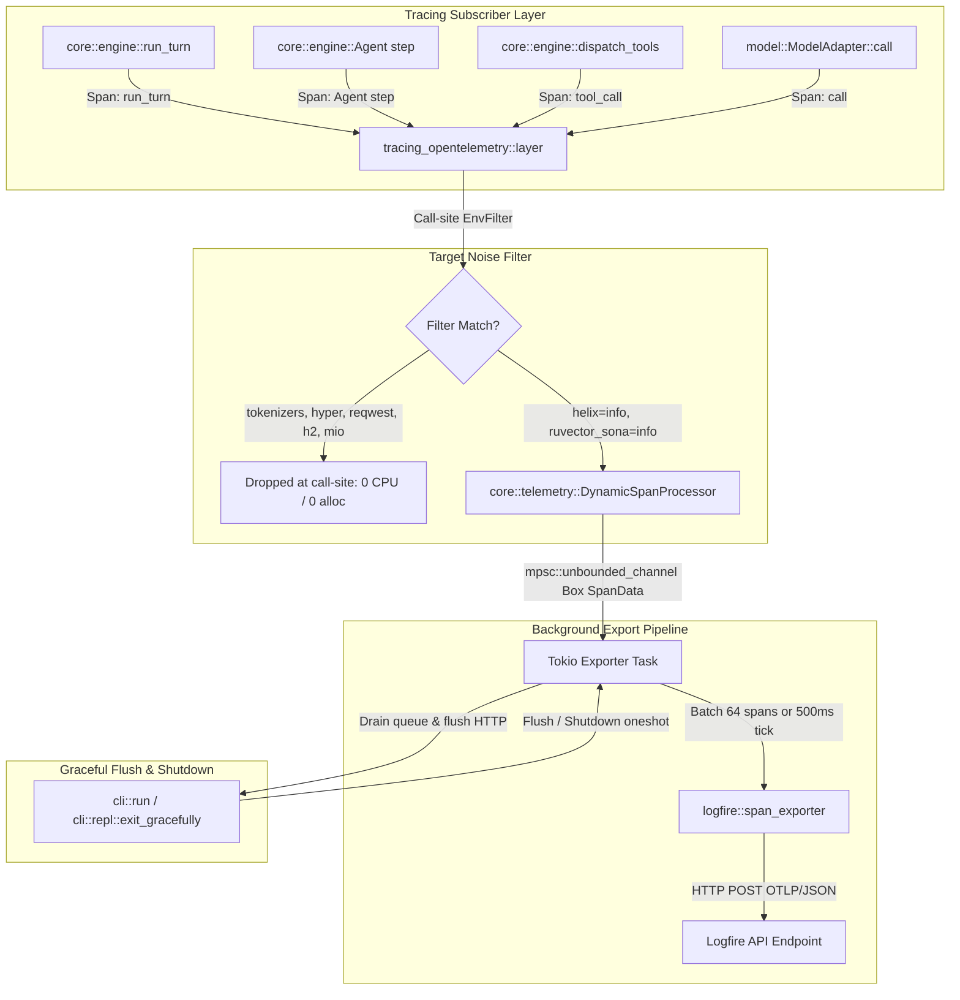

# OpenTelemetry Tracing & Fine-Tuning Telemetry

Helix features a native, asynchronous OpenTelemetry (OTel) telemetry subsystem backed by [Pydantic Logfire](https://pydantic.dev/logfire). Designed specifically for autonomous agent harnesses, Helix structures telemetry not merely for application monitoring, but to **record complete, high-fidelity agent reasoning trajectories that can directly serve as training datasets for fine-tuning small models (1B–8B parameters)**.

---

## 🚀 Quick Start: How to Enable Telemetry

You can enable and configure Logfire telemetry through four convenient methods:

### Method 1: From the Interactive REPL (Recommended)
While inside a Helix chat session, manage telemetry live:
```text
/telemetry on
```
* If a Logfire write token is already saved, telemetry activates immediately.
* If no token is found, Helix prompts: `Enter your Logfire token: ` and saves it to your config file automatically.
* Verify your connection status at any time with:
```text
/telemetry status
```

### Method 2: Interactive Setup Wizard (`helix config`)
Run the configuration wizard from your terminal:
```bash
helix config
```
1. Select option **`Configure Logfire telemetry`**.
2. Choose **`Toggle telemetry (currently: Disabled)`**.
3. When prompted, enter your Logfire write token (obtained from your Logfire dashboard under **Project Settings -> Write Tokens**).
4. The wizard verifies and persists your token and enables telemetry across all future sessions.

### Method 3: Persistent Config File (`config.toml`)
Add the following fields directly to your configuration file (located at `~/.config/helix/config.toml` on Linux, `~/Library/Preferences/com.helix.helix/config.toml` on macOS):
```toml
enable_telemetry = true
logfire_token = "pylf_v1_us_your_write_token_here"
```

### Method 4: Environment Variable & Headless Runs
For headless runs, CI pipelines, or benchmark evaluations, pass your token via environment variable without saving it to disk:
```bash
export LOGFIRE_TOKEN="pylf_v1_us_your_write_token_here"
```
Or enable tracing per command with the `--trace` CLI flag:
```bash
# Headless run with tracing enabled
helix run "Explain the architecture of this repo" --yes --trace

# Interactive REPL with tracing forced on
helix --trace
```

---

## 1. Subsystem Architecture

The telemetry pipeline is built entirely on asynchronous Tokio channels to ensure that tracing never blocks user interactions, terminal streaming, or agent reasoning loops:



### Key Architectural Characteristics
1. **Dynamic Toggling**: Telemetry can be enabled, disabled, or configured with an API token at runtime without corrupting subscriber IDs or requiring application restarts.
2. **Channel Decoupling**: Tracing spans are boxed (`Box<SpanData>`) and dispatched over an asynchronous Tokio unbounded channel (`mpsc::unbounded_channel`). Model execution and CLI rendering continue without I/O pauses.
3. **Synchronized Flush & Shutdown**: Short-lived commands (e.g. `helix run "..." --trace`) use `telemetry.flush().await` and `telemetry.shutdown().await` with `tokio::sync::oneshot` channels to ensure all spans reach Logfire before process termination.
4. **Endpoint Resolution**: Automatically detects and routes telemetry to regional endpoints (US, EU, Staging) by parsing the embedded token prefix (e.g., `pylf_v1_us_...` vs `pylf_v1_eu_...`).

---

## 2. Signal-to-Noise Ratio (SNR) Optimization

When autonomous agents run local models or ONNX neural embedders, low-level dependencies emit thousands of character-level micro-spans. In naive configurations, over **97%** of captured spans are pure noise:

### Raw Trace Breakdown (Before vs. After Optimization)

| Trace Span Category | Spans per Turn (Before) | Spans per Turn (After) | Status & Impact |
| :--- | :--- | :--- | :--- |
| **`tokenizers` character spans** | **120+ spans (~80%)** | **0 spans (0%)** | **Filtered**: Character normalizations, BPE byte alignments (`Replacing char 'x'`, `Total bytes to remove: 0`). |
| **`hyper` / `reqwest` / `mio`** | **~25 spans (~17%)** | **0 spans (0%)** | **Filtered**: Socket polling, TCP handshakes, HTTP connection pool checkouts. |
| **`run_turn` (Root Trajectory)** | 1 span | 1 span | **Signal**: Turn input, final output, latency, session ID, quality score. |
| **`call` (LLM Generation)** | 2 spans | 2 spans | **Signal**: Token usage (`input`, `output`, `total`), provider, model. |
| **`tool_call` (Action / Observation)** | 1 span | 1 span | **Signal**: Tool name, arguments, observation output, success boolean, errors. |
| **`Agent step` (Loop Transition)** | 2 spans | 2 spans | **Signal**: Reasoning iteration boundaries. |
| **Total Trace Volume** | **~150+ spans** | **7 spans** | **>95% reduction in trace payload, >85% pure training signal** |

### Call-Site Filter Implementation
In `src/core/telemetry.rs`, the OpenTelemetry layer is wrapped with an explicit `EnvFilter` applied at the subscriber level:

```rust
let otel_filter = EnvFilter::try_from_default_env().unwrap_or_else(|_| {
    EnvFilter::new(
        "helix=info,ruvector_sona=info,tokenizers=off,hyper=off,hyper_util=off,reqwest=off,h2=off,mio=off,want=off,fastembed=warn",
    )
});
let otel_layer = tracing_opentelemetry::layer()
    .with_tracer(otel_tracer)
    .with_filter(otel_filter);
```

Because `tracing` uses call-site caching with atomic integer checks, silenced spans from `tokenizers` and `hyper` incur near-zero CPU overhead and zero heap allocations.

---

## 3. Dataset Schema for Small Model Fine-Tuning (SFT / DPO)

Fine-tuning small language models (1B to 8B parameters, such as Qwen-2.5, Llama-3, or Gemma-2) on agentic workflows requires clean trajectory data consisting of:
1. **User Goal / Instructions**
2. **Model Thought / Action Choice**
3. **Structured Tool Invocations**
4. **Environment Observations**
5. **Quality Labels (for Direct Preference Optimization / RLHF)**

Helix instruments these fields directly onto OpenTelemetry spans:

### Span Attributes

#### 1. `run_turn` (Root Conversation Turn)
* `session_id`: Unique identifier for the chat session (`YYYYMMDD_HHMMSS`).
* `turn`: Zero-indexed integer turn number within the session.
* `input`: The exact user query or instruction.
* `output`: The final assistant text response.
* `model` & `provider`: The LLM used to execute the turn.
* `dataset.is_training_signal`: Boolean (`true`) for filtering queries.
* `dataset.quality_tier`: Categorical rating (`"high"` | `"medium"` | `"low"`):
  - `"high"`: SONA quality reward $\ge 0.8$ or successful turn with zero healer retries.
  - `"medium"`: Succeeded with minor retries or quality $0.5 \le q < 0.8$.
  - `"low"`: Tool execution failure, unresolvable syntax errors, or $q < 0.5$.
* `dataset.tools_used`: Comma-separated list of unique tools called (e.g. `"read_file,bash"`).
* `dataset.has_healer_retries`: Boolean flag indicating if self-healing was triggered.
* `dataset.healer_retry_count`: Total count of schema repair iterations.
* `sona_quality`: Float representation of the neural trajectory reward (0.0 to 1.0).

#### 2. `tool_call` (Environment Action & Observation)
* `tool.name`: Name of the executed tool (e.g. `read_file`, `bash`, `web_search`).
* `tool.id`: Correlation ID of the tool call.
* `tool.args`: Complete JSON arguments supplied by the model.
* `tool.output`: Execution output/observation returned by the sandbox (truncated to 2,048 chars for training safety).
* `tool.error`: Detailed error message if the tool failed.
* `tool.success`: Boolean indicating whether the tool completed without errors.
* `dataset.is_training_signal`: Boolean (`true`).

#### 3. `call` (Model Generation Step)
* `gen_ai.system`: Provider identifier (e.g. `Custom (OpenAI-compatible)`, `Ollama`).
* `gen_ai.request.model`: Target model name.
* `gen_ai.usage.input_tokens`: Prompt token count.
* `gen_ai.usage.output_tokens`: Completion token count.
* `gen_ai.usage.total_tokens`: Total token count.
* `response_type`: Type of model response (`tool_calls(N)`, `end_turn`, `markdown_tool_call`).
* `dataset.is_training_signal`: Boolean (`true`).

---

## 4. Extracting Datasets via Logfire MCP

Helix can be connected directly to Logfire's Model Context Protocol (MCP) endpoint (`https://logfire-us.pydantic.dev/mcp`) to inspect live traces and extract fine-tuning datasets using DataFusion SQL.

### Example 1: Supervised Fine-Tuning (SFT) Extraction
Extract high-quality turns and tool executions formatted for instruction-tuning:

```sql
SELECT
    attributes->>'session_id' as session_id,
    attributes->>'turn' as turn,
    attributes->>'input' as prompt,
    attributes->>'output' as response,
    attributes->>'dataset.tools_used' as tools_used,
    duration as turn_latency_s
FROM records
WHERE span_name = 'run_turn'
  AND attributes->>'dataset.is_training_signal' = 'true'
  AND attributes->>'dataset.quality_tier' = 'high'
ORDER BY start_timestamp DESC;
```

### Example 2: Direct Preference Optimization (DPO) Pair Extraction
Extract `chosen` vs `rejected` trajectory pairs for alignment:

```sql
SELECT
    attributes->>'input' as prompt,
    attributes->>'output' as completion,
    attributes->>'dataset.quality_tier' as preference_label,
    attributes->>'sona_quality' as reward_score,
    attributes->>'dataset.healer_retry_count' as retries
FROM records
WHERE span_name = 'run_turn'
  AND attributes->>'dataset.is_training_signal' = 'true'
  AND attributes->>'dataset.quality_tier' IN ('high', 'low')
ORDER BY start_timestamp DESC;
```

---

## 5. Memory Embedding Cache Optimization

During semantic context retrieval, Helix computes 384-dimensional dense vector embeddings using `fastembed-rs` and the offline ONNX model `bge-small-en-v1.5`.

* **Bottleneck Identified via Telemetry**: `embed_text` was previously invoked twice per turn (once in `run_turn` for SONA trajectory setup and once inside `HelixMemoryEngine::search`), taking ~1.5s per invocation.
* **In-Memory Cache**: `HelixMemoryEngine` incorporates an internal embedding cache (`HashMap<String, Vec<f32>>` bounded to 512 entries).
* **Performance Gain**: Identical query texts hit the in-memory cache in **0.001 ms**, cutting turn startup latency by **~1.5 seconds**.

---

## 6. CLI Commands & Configuration

### REPL Telemetry Commands
Manage telemetry directly from the interactive REPL:

```text
/telemetry status           - Display current telemetry status, endpoint, and token preview
/telemetry on               - Enable Logfire telemetry (prompts for write token if not set)
/telemetry off              - Disable telemetry (preserves saved token in config)
/telemetry token <token>    - Update and persist a new Logfire write token
```

### Persistent Configuration (`~/.config/helix/config.toml`)
Telemetry settings persist across sessions in the user configuration file:

```toml
telemetry_enabled = true
logfire_token = "pylf_v1_us_your_write_token_here"
```

### Environment Variables
* `LOGFIRE_TOKEN`: Set the Logfire write token via environment variable without writing to disk.
* `RUST_LOG`: Override default logging levels (e.g., `RUST_LOG=helix=debug`).

### Headless CLI Flag
Capture traces during automated test runs or CI benchmark tasks:

```bash
helix run "Check the version in Cargo.toml and tell me" --yes --trace
```
